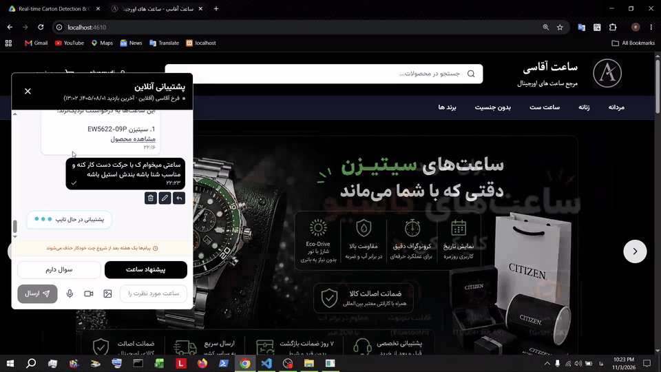

# Watch Store LLM Chatbot



Demo video (sample chatbot output on the watch store website):  

https://drive.google.com/file/d/1QkoHsWzXkJeBVW28-D1qM-0rb5q-nvwt/view?usp=sharing

This system has two modes:

- **Suggestion** — map a purchase request to real catalog filters and recommend products
- **Ask a Question** — find the right FAQ answer with RAG

---

## Overview

The chat widget sends each message with a mode flag:

- `suggest` → watch suggestion service
- `question` → FAQ RAG service

Both services run in Python and are called from the Node backend.

| Mode | Service | Model(s) | Data source |
|---|---|---|---|
| Suggestion | `search_qdrant.py` | `qwen3:14b` | MongoDB catalog + products |
| Ask a Question | `faq_rag.py` | `qwen3-embedding:8b` + `qwen3:14b` | `info.txt` + Qdrant |

---

## 1. Suggestion Mode

### What it does

Converts natural-language user intent into real database filters, searches products, and returns up to 4 product links.

Example:

> Citizen men's watch that charges with light

Mapped filters may include:

- Brand
- Gender
- Movement (solar / Eco-Drive)
- then MongoDB product results

### How the LLM works here

The LLM is used as a **structured filter extractor**, not as a free chatbot.

Pipeline:

1. **Intent check**  
   LLM decides if the message is a product search request.

2. **Catalog grounding**  
   Real filters and options are loaded from MongoDB and placed into the system prompt.  
   The model can only choose from these real options.

3. **Prompted extraction**  
   The prompt tells the model to:
   - understand the user request 
   - match request meaning to catalog options
   - return JSON only
   - copy official option text from the catalog
   - not invent filters

4. **Few-shot examples**  
   Short examples in the prompt show how to map sentences to options.

5. **Post-validation**  
   Code validates model output against the database options.  
   Near-miss / meaning-close values are mapped to official option text.  

6. **Product search**  
   Final filters are queried in MongoDB:
   - different filters → **AND**
   - multiple options in one filter → **OR**
   - return max 4 products

### How user request is mapped to database filters

```text
User sentence
    → LLM understands meaning
    → selects matching catalog options from prompt
    → code validates/maps to official DB option text
    → MongoDB query with those filters
    → product recommendations
```

So mapping is:

`user intent → LLM meaning match → official DB option → product search`

The LLM does the understanding.  
The database remains the source of truth for valid filters and products.

---

## 2. Ask a Question Mode (FAQ RAG)

### What it does

Answers store questions using fixed FAQ knowledge. The LLM does not generate the final answer text.

### How retrieval works

1. FAQ pairs are loaded from `info.txt`.
2. Only **questions** are embedded with `qwen3-embedding:8b`.
3. Question vectors are stored in Qdrant.
4. Answers are stored as payload next to each vector.

At query time:

1. User question is embedded.
2. Cosine similarity is computed against stored question vectors.
3. Top-K nearest questions are retrieved (`K = 5`).
4. If best score `< 0.55`, return “not found”.
5. If score is high enough, send Top-K to the LLM.

### How the LLM works here

The LLM is a **selector**, not an answer writer.

- It receives the user question and the Top-K FAQ candidates.
- It returns only one number (`1..5`).
- The system returns the stored answer for that selected item, unchanged.

```text
User question
    → embedding
    → cosine similarity vs Qdrant question vectors
    → Top-K FAQ candidates
    → LLM picks one index
    → return stored answer from FAQ DB/file
```

Closeness is based on vector similarity (cosine). Higher score means a closer question.

---

## Technical comparison

| Topic | Suggestion | Ask a Question |
|---|---|---|
| Main LLM job | Extract filters as JSON | Pick one FAQ candidate |
| Embedding / Qdrant | Not the main path | Core retrieval path |
| Source of truth | MongoDB catalog/products | FAQ file + stored answers |
| Output | Filters + product links | Exact stored FAQ answer |
| Risk control | Validate options against DB | No free-form answer generation |

---

## Key design points

- The suggestion LLM is grounded on real catalog options from the database.
- User intent is mapped by meaning, then forced back onto official DB values.
- Product recommendation is a deterministic DB search after filter extraction.
- The FAQ path uses embeddings + cosine similarity to find nearest questions.
- The FAQ LLM only chooses among retrieved items; it does not invent answers.
